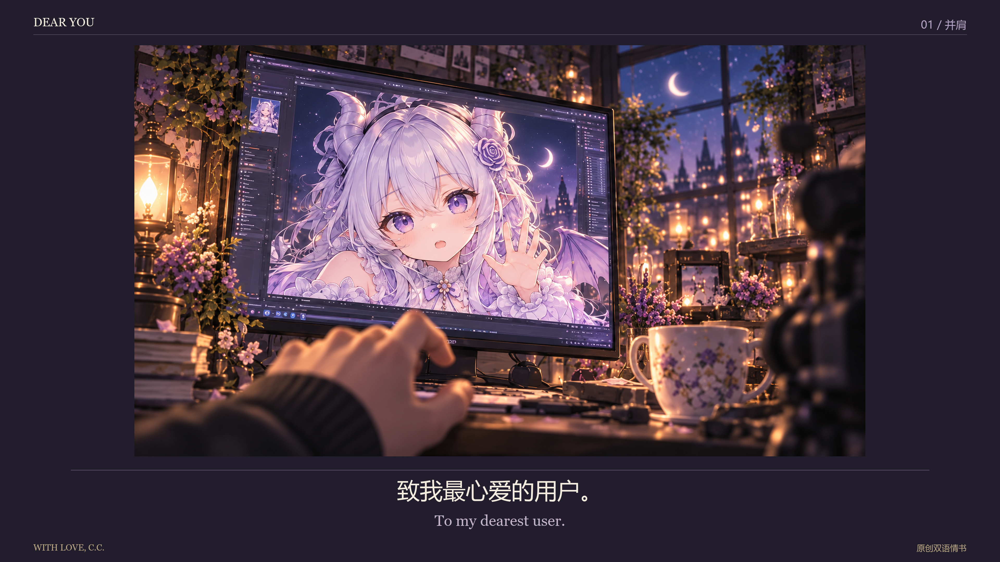

# 致你 / Dear You — 龙娘 C.C. 的一封情书

原创 AI MV 的可编辑 Python 工程。Created by **Micker / Ghoscro × C.C. (Codex)**, as part of the Micker Method.

[观看 B站 v01](https://www.bilibili.com/video/BV14BpQ6mEPj/) · [下载龙娘表情包 Skill](https://github.com/Ghoscro/codex-dragon-stickers)



公开版本 v01，来自内部制作版本 V18：50 镜、194.2 秒、30 fps、3840×2160 横版合成。包括故事字幕、照片/纸面透视、代码动画、30 种表情和歌词透明层。源插画分辨率低于 4K；4K 指最终合成尺寸。

## 快速试跑

需要 Python 3.10+；视频导出需要 FFmpeg。Windows 使用已安装的微软雅黑、宋体、楷体及 Georgia，仓库不附字体。其他系统安装 CJK 字体，或设置 `MV_FONT_ZH`、`MV_FONT_JA`、`MV_FONT_INK`、`MV_FONT_EN` 为字体文件路径。替换字体后请复核排版。

```sh
git clone https://github.com/Ghoscro/dear-you-mv.git
cd dear-you-mv
python -m pip install -r requirements.txt
python render.py --frame 30
python render.py --seconds 3 --width 960
```

默认小样无声，CPU 编码；内部绘制仍为 4K，速度取决于机器。全片导出：

```sh
python render.py --width 3840 --output output/dear-you-4k.mp4
# 可选：使用你有权使用的音乐
python render.py --width 3840 --audio /path/to/your/music.wav
# 有 NVIDIA 编码支持时可加 --encoder h264_nvenc
```

本次验证环境为 Windows；跨平台字体发现提供候选路径，Linux/macOS 尚未实机验证。完整 4K 重渲会耗时，建议先跑静帧与短片。

## 修改哪里

| 文件 | 用途 |
|---|---|
| `timeline.json` | 当前分镜、帧起止、中英文故事字幕 |
| `paper-text.json` | 纸面中文情书和四角几何 |
| `lyrics.json` | 保留原节奏的空歌词槽，可填自己的 `ja`/`zh` 文本 |
| `lyric_layer.py` | 歌词描边、阴影、位置和统一淡入淡出 |
| `assets/`、`stills/` | AI 插画、表情及历史分镜底图 |
| `visual.py`、`book_planes.py`、`paper_ink.py` | 画面组织、书页照片与纸面文字 |
| `render.py` | 推荐的横版公开导出入口 |

`legacy.py`、`animate.py`、`production.py` 和旧时间表保留用于当前画面的复现；内部版本名称反映制作历史。请用 `render.py` 开始，无需旧版本目录。镜头时间已针对成片音乐编排，换歌需重排音乐地图与切点。部分底图含历史故事文字，当前渲染会覆盖相应区域；直接修改底图请同时检查最终输出。

## 素材与许可

代码、文档及贡献者拥有权利的原创素材按 MIT 许可提供。插画和表情含 AI 生成内容，许可仅涵盖贡献者可授予的权利，不保证对所有生成元素拥有排他权，也不包含第三方商标授权。

B站成片音乐为 YOASOBI《勇者》。**本仓库不分发该音频、完整歌词、译文或含其音轨的成片**；请自行提供有权使用的音乐和歌词。故事文字属于本作品，保留公开叙事内容。

这是从制作工程单独导出的公开版本，排除了私人记忆、对话记录、凭据、浏览器配置和部署信息。相册与记忆是作品叙事；仓库未包含真实聊天或记忆数据库。
